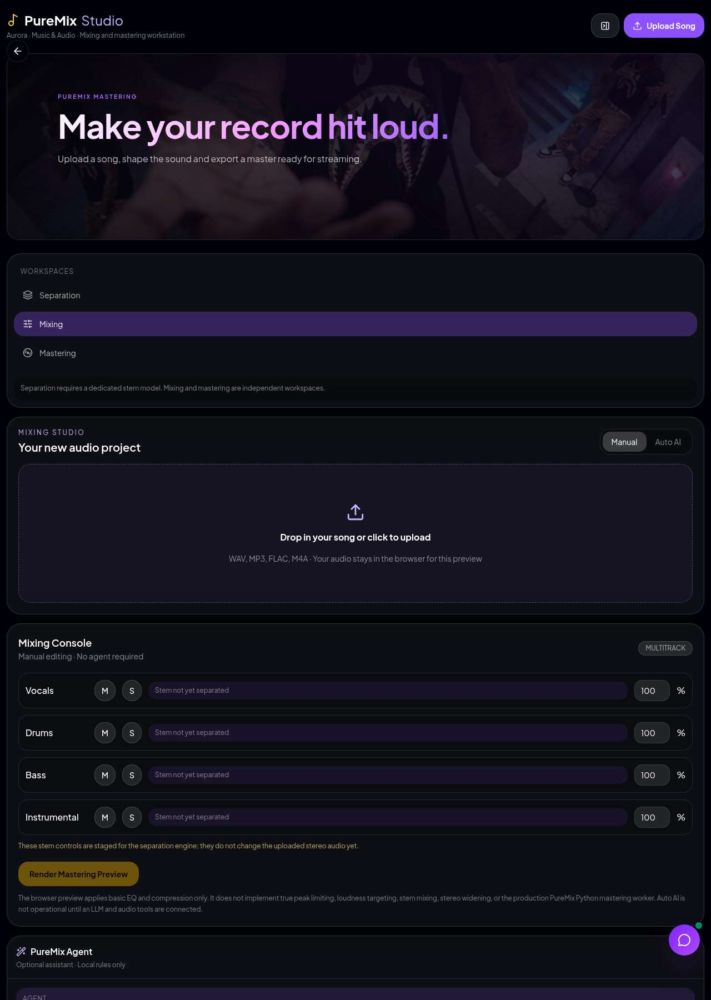
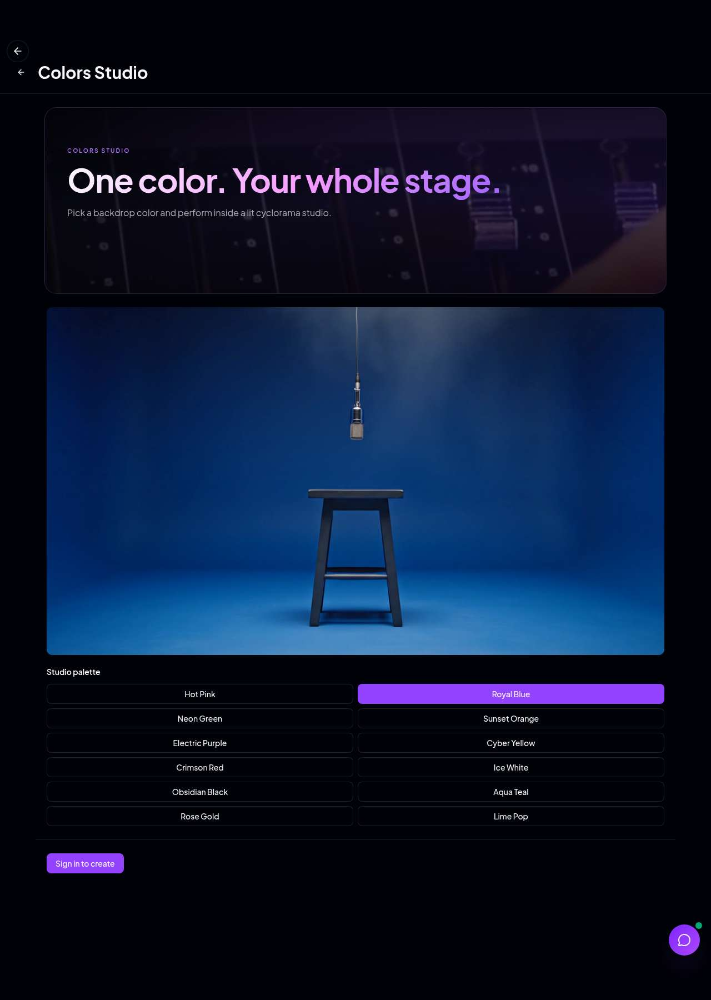
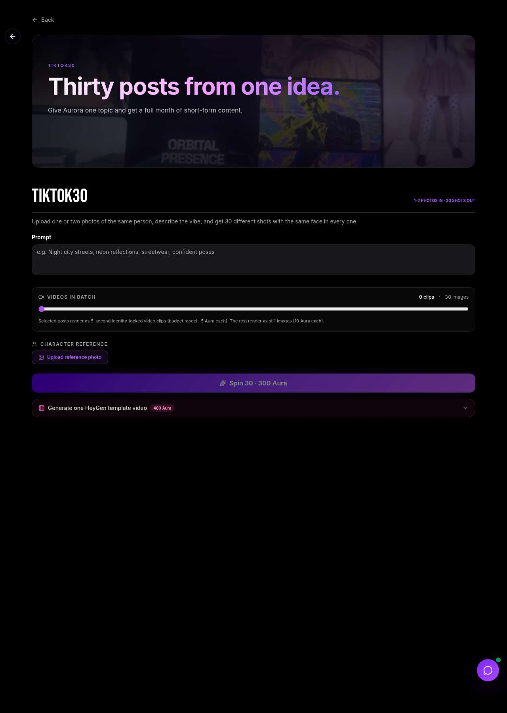

# Aurora Setup Guide

https://github.com/josephcrown920/Auroraglobal.git SET UP THIS PROJECT

## Lovable handoff (start here)

See [`lovable-updates/HANDOFF.md`](lovable-updates/HANDOFF.md) for the full work log, where development stopped, open blockers, and page screenshots in `lovable-updates/screenshots/`.

Locked appearance rules: [`lovable-updates/UI-UX.md`](lovable-updates/UI-UX.md). Snapshot history: [`lovable-updates/SNAPSHOT.md`](lovable-updates/SNAPSHOT.md).

This project was built with [Lovable](https://lovable.dev).


## Flagship suite (current snapshot)

Genjutsu (Perform Anywhere and GRWM), Colors Studio, Multi-Angle Camera, TikTok30, Video Agent, PureMix Mastering, Soul Studio and GUI Studio. Generation runs through Kie via API.

| Page | Snapshot |
|---|---|
| home |  |
| create |  |
| perform-anywhere |  |
| puremix |  |
| soul |  |
| colors |  |
| lipsync |  |
| spin |  |

## Repository sync

Main repository: `josephcrown920/Auroraglobal`. Lovable syncs to its own connected repository; merge that repository's branch into Auroraglobal on GitHub.

## Build with Lovable

Continue developing this project in the [Lovable editor](https://lovable.dev/projects/ef1659c1-5a68-487a-b6a8-e9ff9db3ca7e).

- **Ship faster**: describe what you want to build and Lovable handles the code.
- **Stay in sync**: every change made in Lovable is committed straight to this repository.
- **Full ownership**: this code is yours. Push to `main` on GitHub and your changes sync back into Lovable, ready for your next prompt.

## Development

Prefer working locally? You need Node.js and npm — [install with nvm](https://github.com/nvm-sh/nvm#installing-and-updating).

```sh
git clone <this-repository-url>
cd <repository-name>
npm i
npm run dev
```
